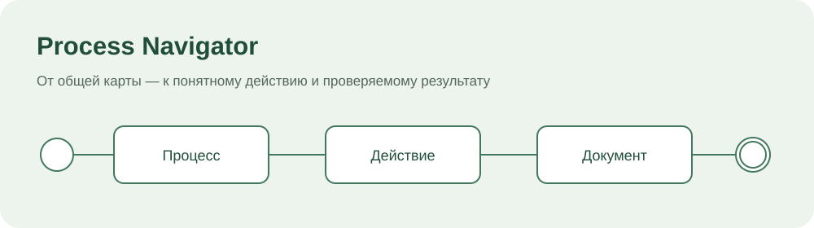

<h1 align="center">Process Navigator</h1>

Существующие процессы → понятные действия → проверяемые результаты

 

<a href="docs/user-manual.md">Руководство</a> · <a href="docs/release-notes/0.2.0-preview.116-dev.md">Что нового</a> · <a href="docs/development-decomposition.md">Полная дорожная карта</a> · <a href="SECURITY.md">Безопасность</a>

**Локальное рабочее пространство для бизнес-процессов:** загрузить существующие схемы, проверить обрывы, описать документы и системы, раскрыть детализацию и рассчитать сроки от начала или требуемого результата.

Приоритет — работа с действующими процессами. AS-IS/TO-BE, развитие согласований, интеграции и промышленная инфраструктура — отдельные, отложенные направления.

> **Предварительная версия, не промышленная поставка.** В комплекте только вымышленные учебные организации и процессы. Переключение демонстрационных профилей не заменяет настоящую аутентификацию. Используйте локальный доступ; не публикуйте сервер в Интернет.

## Возможности

| Направление | Что доступно |
| --- | --- |
| Карта и каталог | Организации, подразделения, направления, владельцы-подразделения, поиск, избранное и история открытий |
| BPMN и детализация | Просмотр и редактор, дорожки, черновики и версии, раскрытие дочерних схем на той же странице, отдельные обзор и инструкция |
| Работа по процессу | Карточки этапов, системы и каналы, результаты, экземпляры, пауза, возврат, история; ручная и системная ответственность разделены |
| Документы и результаты | Реестр со стабильными ID, версии и состав, производители/получатели, граф связей, диагностика разорванных передач |
| Обмен | XLSX-шаблон, экспорт, проверка без записи, сравнение, сопоставление ID, уточнение справочников, повторяемые наборы загрузки и ZIP моделей |
| Качество | Обрывы, достижимость, циклы, оргпривязки, полнота описания, границы уровней, читаемость схем и переход к замечанию |
| Происхождение сведений | Факты, предположения и вопросы; оригинал с SHA-256, содержанием, координатой и автором; привязка к процессу, этапу, переходу или документу |
| Предметная сверка | Пункты описания и проверка пути; ручное подтверждение по оригиналу, замечание, отзыв и журнал снимков |
| Калькулятор сроков | Прямой/обратный расчёт, работа/ожидание/передача, календари процессов, выбор альтернатив, ограниченные возвраты, сценарии и снимки |
| План / факт | Назначение расчёта выполнению, история замен, актуальность исходников, таблица отклонений и CSV |
| Аналитика | Полноразмерная страница: готовность фонда, пробелы, документы, системы, ответственность, уровни и зарегистрированные просрочки; фильтры и переход к данным |
| Обслуживание | Рабочие страницы, адаптивность, клавиатура, руководство, версии и визуальная карта разработки, аудит, диагностика и резервирование |

Последний выпуск — [**0.2.0-preview.116-dev**](https://github.com/Wolfhander/process-navigator-community/releases/tag/v0.2.0-preview.116-dev). Он объединяет изменения после .66-dev: документы и передачи, детализацию и печать, расчёты, аналитику, план/факт, источники, ручную сверку и надёжность интерфейса/хранения.

В дорожной карте **97 из 103 шагов** приняты по описанным критериям. Это **не процент промышленной готовности**. [Изменения и ограничения выпуска](docs/release-notes/0.2.0-preview.116-dev.md).

Текущая ветка main (.122-dev, ещё не отдельный выпуск) добавляет историческую ответственность выполнений, явную приёмку результатов, булевы условия документов и диапазоны альтернативных сроков. Средняя номинальная длительность не выдаётся за гарантированную дату. Проверки: 430 клиентских тестов, 970 серверных сценариев и 18 групп браузер/API. [Протокол условий и ограничений](master-data/schedule-conditions-acceptance-2026-11-07.md), [историческая ответственность](master-data/responsibility-receipts-acceptance-2026-11-06.md).

## Запуск в Windows

### Из исходников с обновлением

Нужны Git, .NET SDK 9, Node.js 22.12+ и pnpm/Corepack. Обычный запуск не требует администратора.

1. Скачайте [Start-ProcessNavigator.cmd](https://raw.githubusercontent.com/Wolfhander/process-navigator-community/main/Start-ProcessNavigator.cmd) и запустите двойным щелчком.
2. Сценарий получит код, соберёт приложение и откроет **http://127.0.0.1:5081**.
3. Выберите учебный профиль. Для полного осмотра используйте демонстрационного суперадминистратора: аналитика и настройки зависят от прав.

| Назначение | Каталог |
| --- | --- |
| Код | %LOCALAPPDATA%\ProcessNavigatorCommunity\source |
| Данные | %LOCALAPPDATA%\ProcessNavigatorCommunity\runtime\Data |
| Логи | %LOCALAPPDATA%\ProcessNavigatorCommunity\logs |

Рабочие данные сохраняются отдельно от исходного кода. Сценарий **не делает коммиты, не отправляет данные и не сбрасывает фонд**. Он не останавливает чужие процессы. Для обновления завершите свою серверную сессию. При занятом порте или ручных правках исходников сценарий выдаёт объяснение.

### Готовая автономная сборка

В [релизе](https://github.com/Wolfhander/process-navigator-community/releases/tag/v0.2.0-preview.116-dev) публикуются Windows x64 ZIP и SHA-256. Распакуйте ZIP целиком в отдельную пользовательскую папку, запустите **включённый в архив** Start-ProcessNavigator.cmd. Адрес — **http://localhost:5080**, данные — app\Data. Node.js, Git и установленный .NET Runtime для этого пакета не нужны.

Не смешивайте два сценария запуска. Перед обновлением сохраните данные; [порядок переноса и необязательная установка службы](docs/offline-deployment.md). Для переносного режима администратор не нужен.

## Важные границы

- Отметка выполнения **не запускает ERP, PLM или КОМПАС**. Прототип интеграции не равен промышленному обмену.
- Расчёт зависит от норм и полноты связей. Есть предварительные даты и неопределённости. Календари подразделений автоматически не назначаются; полная семантика таймеров и сообщений ещё не реализована.
- Повторы поддержаны для ограниченного простого возвратного участка, не любых вложенных циклов. Критический путь при разных календарях остаётся номинальным.
- SHA-256 проверяет байты. Ручная сверка — решение профиля по снимку, не подпись и не доказательство истинности сведений или исполнения.
- Оригиналы и журналы входят в резервирование, но **не переносятся с моделью в BPMN/XLSX/ZIP** автоматически.
- Данные файловые: JSON/BPMN. Для промышленной эксплуатации нужны аутентификация, HTTPS, права, СУБД и эксплуатационная приёмка.

## Проверки и разработка

~~~powershell
git clone https://github.com/Wolfhander/process-navigator-community.git
cd process-navigator-community
dotnet build backend/ProcessNavigator.Api -c Release
dotnet run --project backend/ProcessNavigator.Checks -c Release
corepack pnpm --dir frontend/process-navigator-ui install --frozen-lockfile
corepack pnpm --dir frontend/process-navigator-ui build
node --experimental-strip-types --test frontend/process-navigator-ui/tests/*.test.mjs
~~~

На .116-dev локально прошли **409 клиентских тестов и 799 серверных сценариев**, HTTP-проверки и 11 групп живого браузер/API-маршрута. Это учебная приёмка, не исчерпывающее покрытие всех окружений. Протоколы: [сверка](master-data/reconciliation-acceptance-2026-11-05.md), [источники](master-data/provenance-acceptance-2026-11-05.md), [план/факт](master-data/plan-fact-acceptance-2026-11-05.md).

**Стек:** ASP.NET Core / .NET 9 · React · TypeScript · Vite · bpmn-js.

## Документация и участие

- [Руководство](docs/user-manual.md), [рабочее место](docs/local-workstation.md), [дорожная карта продукта](docs/roadmap.md) и [все 103 шага](docs/development-decomposition.md)
- [Табличный обмен](docs/process-table-exchange.md), [декомпозиция](docs/process-decomposition.md), [демо-контур](docs/demo-showcase.md)
- [Что нового](docs/release-notes/0.2.0-preview.116-dev.md); полный журнал версий — в программе: «Настройки → Версии программы»
- [Ранняя история решений](docs/development-history.md) и [очищенная инженерная хронология](docs/engineering-timeline.md)
- [Участие](CONTRIBUTING.md) и [безопасность](SECURITY.md)

Публичная история начинается с очищенного снимка; прежние закрытые Git-объекты, реальные структуры, ключи и рабочие материалы не переносились. Ветка main может быть новее релиза. Новые Releases выпускаются только по прямому запросу.

**Лицензия пока не выбрана.** Публичность кода не означает предоставления открытой лицензии; лицензии зависимостей действуют отдельно.
