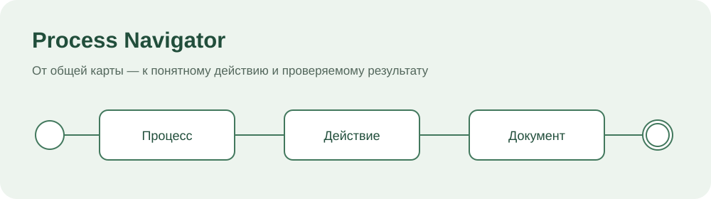
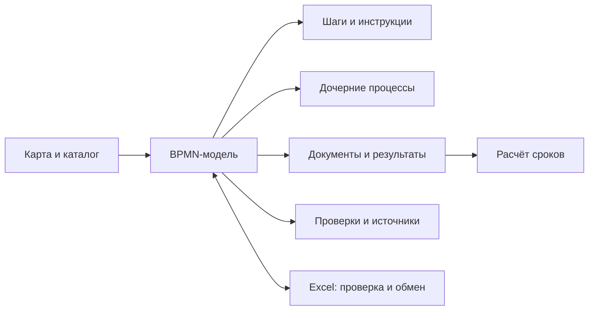

<p align="center"></p>

<h1 align="center">Process Navigator</h1>
<p align="center">BPMN-схемы · документы · декомпозиция · проверка · расчёт сроков</p>
<p align="center"><a href="docs/user-manual.md">Руководство</a> · <a href="docs/roadmap.md">Дорожная карта</a> · <a href="docs/development-history.md">История решений</a> · <a href="SECURITY.md">Безопасность</a></p>

Process Navigator — локальное рабочее пространство для существующих бизнес-процессов. От карты предприятия можно перейти к подробной схеме, инструкции исполнителю, входам, результатам и документам. Программа находится в **предварительной разработке**, не предназначена для промышленного размещения без отдельного усиления безопасности.

## Возможности

| Задача | Что доступно |
| --- | --- |
| Читать и описывать процессы | BPMN 2.0, редактор, дорожки подразделений, черновики и версии |
| Разбирать сложные модели | Уровни 0–4 и глубже, раскрытие дочерних схем на той же странице |
| Работать с документами | Реестр входов/выходов, связи между процессами и поиск разрывов |
| Проверять модели | Обрывы, достижимость, циклы, оргпривязки и полнота описания |
| Переносить через таблицы | XLSX-шаблон, предварительная проверка, сравнение, сопоставление ID и обратная выгрузка |
| Сверять с источником | Факты, предположения, вопросы, пункты исходного описания и проверка направленного пути |
| Рассчитывать сроки | Вперёд от запуска и назад от результата, отдельные календари процессов с UTC-сдвигом, межпроцессные передачи; локальные снимки и сравнение сценариев |
| Применять схемы | Экземпляры, ручные действия, результаты, пауза, возврат и история исполнения |

В комплекте — только синтетический учебный контур. Физическое действие, работа сотрудника в системе и автоматическая обработка различаются. Отметка в навигаторе **не запускает ERP** и не заменяет подтверждение результата внешней системой.

## Запуск в Windows

Нужны **Git, .NET SDK 9, Node.js 22.12+ и pnpm/Corepack**. Администратор для обычного запуска не требуется.

1. Скачайте один файл: [Start-ProcessNavigator.cmd](Start-ProcessNavigator.cmd). Он получит актуальный сценарий запуска из этого публичного репозитория по HTTPS.
2. Дважды нажмите `Start-ProcessNavigator.cmd`.
3. После получения кода и сборки откроется `http://127.0.0.1:5081`.

Исходники размещаются в `%LOCALAPPDATA%\ProcessNavigatorCommunity\source`, рабочие данные — отдельно, в `%LOCALAPPDATA%\ProcessNavigatorCommunity\runtime\Data`. Обновления получают только код и шаблоны. Скрипт **не делает коммиты и не отправляет данные**, не сбрасывает существующую базу и не останавливает чужие процессы. Если исходники изменены вручную или порт занят, он останавливается с объяснением.

Если сервер уже работает, просто откройте адрес в браузере. Для обновления сначала завершите свою предыдущую сессию сервера. Порядок переноса данных и дополнительные параметры — в [инструкции запуска](docs/local-workstation.md).

## Разработка

```powershell
git clone https://github.com/Wolfhander/process-navigator-community.git
cd process-navigator-community
dotnet build backend/ProcessNavigator.Api
corepack pnpm --dir frontend/process-navigator-ui install --frozen-lockfile
corepack pnpm --dir frontend/process-navigator-ui build
node --experimental-strip-types --test frontend/process-navigator-ui/tests/*.test.mjs
```

## Как устроено



**Стек:** ASP.NET Core / .NET 9, React, TypeScript, Vite, bpmn-js. На текущем этапе данные хранятся локально в JSON и BPMN. Промышленная аутентификация, СУБД и внешние интеграции — отдельные этапы.

## История без рабочих данных

В [журнале развития](docs/development-history.md) сохранены 27 этапов и основные решения: что добавлялось, менялось, исправлялось и удалялось. Дополнительно сохранена [хронология 131 инженерной итерации](docs/engineering-timeline.md) без авторов, SHA и рабочих вложений. История Git этого репозитория начинается с очищенного снимка. Прежние Git-объекты, архивы, ключи, пользователи, реальные структуры и материалы обследования сюда не переносились.

## Документация и участие

- [Руководство пользователя](docs/user-manual.md)
- [Полная декомпозиция разработки](docs/development-decomposition.md)
- [Табличный обмен](docs/process-table-exchange.md)
- [Декомпозиция процессов](docs/process-decomposition.md)
- [Учебные сценарии](docs/demo-showcase.md)
- [Правила участия](CONTRIBUTING.md)
- [Ограничения и безопасность](SECURITY.md)

**Лицензия пока не выбрана.** Публичная доступность кода сама по себе не означает предоставление открытой лицензии. Лицензии зависимостей действуют отдельно.
